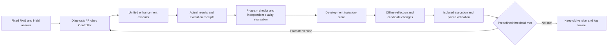

As of 2026-10-23, this project has a reproducible Reference RAG, preliminary experiments, frozen Diagnosis/Probe/Controller routing, and component implementations of the three enhancement routes. Not yet completed are a unified executor, a joint answer-quality comparison of the three enhancements, and end-to-end benefit acceptance. RSI can serve as a later trajectory-driven optimisation layer, but at present "the model proposed a plan" or "component tests passed" cannot be counted as a successful closed-loop improvement.

This run successfully executed `git fetch origin`, checked all 10 remote branches and 4 local branches, and read module implementations, interfaces, tests and saved results. Cross-branch checks used Git references and temporary independent snapshots; no working branch was merged, switched or pushed, no new GPU experiment was run, no model was trained and no raw data was modified. The existing untracked file `data/annotations/assisted/answer_repair_v7_batch01_20261017.jsonl` was kept. Review artifacts are in the [audit directory](../artifacts/project_audit_20261023/); file hashes, environment and check scope are in the [manifest](../artifacts/project_audit_20261023/manifest.json).

**Branch inventory and completion status.** Whether a branch exists, whether code is implemented, and whether an experiment achieved a benefit are judged separately; no overall completion percentage is given in the absence of a shared acceptance criterion.

| Remote branch | Checked commit | Actual content and boundaries |
|---|---|---|
| main | `058f10b` | Reference RAG and the NQ Train 74,097-item C1 delivery pipeline; Diagnosis and the three enhancements are not integrated. The README's "preliminary experiments not yet started" is outdated. |
| feature/nq-c0-c1 | `bcb248c` | NQ 500-item C0/C1 preliminary experiment. |
| feature/nq-c3 | `8b03009` | NQ C3 and paired recovery analysis, including the C0/C1 results. |
| feature/fever-c1 | `6ebdfc9` | FEVER full-corpus-index C1 on 500 items, retrieval checkpoint, and paired analysis. |
| feature/F500-c0c3 | `1238a4f` | FEVER C0/C3 on 500 items each, and index metadata. |
| feature/-ce-70B | `6f08f2f` | 7B result merge, NQ judge re-evaluation, and Llama 70B comparison on selected hard cases; not an overall accuracy comparison of the two models. |
| feature/diagnosis-probe-zheng | `7c7863f` | Diagnosis v2-expanded, Probe, Safe Binary and Controller routing, with frozen tests; does not execute enhancements. |
| feature/retrieval-enhancement | `1d97780` | Frozen NQ P3-20: original-question BGE Top-20, cross-encoder, equal-weight RRF, select Top-5, at most one re-answer; has execution records and fallback. Does not rewrite the question by default; supports NQ only. Real generation benefit is not yet provided in the branch. |
| reranking | `338ff34` | Reranks the original Top-5 with a cross-encoder, default keep5, conditional re-answer; has a retrieval-side 500-item experiment; final answer improvement not verified. |
| feature/verification-answer-repair | `5da1fe5` | E historical real experiments, human settlement, Qwen v9/evidence ID/constrained output; the new interface has passed the synthetic engineering threshold, with no new real semantic benefit conclusion yet. |

Local `main`, `feature/F500-c0c3` and the E branch are identical to their remotes; local `Qihan` is the old `c15977c`. The remote symbolic reference `origin/HEAD` is not counted as a separate branch. The full file inventory and diff-vs-main inventory are in [branches.json](../artifacts/project_audit_20261023/branches.json). 37 cross-branch preliminary-experiment file references correspond to 15 unique Git blobs; no differing byte versions of the same path were found across branches, see the [artifact inventory](../artifacts/project_audit_20261023/preliminary_artifact_inventory.json). This check is a version-consistency check, not a re-execution of all preliminary experiments.

| Function | Completed | Acceptance still missing |
|---|---|---|
| Reference RAG | Qwen2.5-7B-Instruct NF4, BGE, FAISS, Top-5; actual NQ and FEVER outputs | Unified run resource inventory and branch integration; Train and Dev use different NQ retrieval corpora and cannot be pooled |
| Diagnosis | 27 observable features, two-level logistic regression, frozen model and split | accessibility/utilisation separation is very weak; not a multi-label capability profile, nor a Qwen trained on the 74,000 items |
| Probe/Safe Binary | At most one Qwen Probe when uncertain, changing failure to correct to a limited extent | Cannot fix routing errors among the three failure types; reduces false alarms while missing some true errors |
| Controller | Deterministic mapping of four actions and runtime data boundaries | Still missing a unified executor that actually invokes the three enhancements, a unified result and cost structure, and post-execution feedback |
| Retrieval Enhancement | P3-20 algorithm and interface, protective fallback, call and stage-timing records | FEVER support, real generation and harmful-repair results, full-pipeline runner/resource assembly; the mentioned Phase 5–6 external scoring files are not in the branch, so their numerical benefit cannot be confirmed on their behalf |
| Evidence Refinement | Reranking/optional filtering/conditional re-answer and source checks | Net final-answer benefit on NQ/FEVER; the current default is reranking that keeps all 5 passages, not filtering by default |
| E | Multiple GPU runs, frozen replay, human review, source localisation, budget; new Qwen two-task interface | Benefit under actual routing, real semantic validation of the new interface, new unseen evaluation; no default version with proven positive benefit has been promoted |
| Full system/RSI/LLM fine-tuning | Component interfaces and some trajectory fields are reusable | End-to-end comparison, cross-question reflective optimisation, version promotion/rollback, skill registry, memory updates, distillation/DPO are all not completed |

This run re-executed in a temporary isolated environment: Diagnosis/Probe/Controller 164 tests, retrieval enhancement 155, reranking 68, E core + v9 + constrained interface 48, for a total of **435 passed**. All are CPU unit/contract checks, with model collaborators mostly stubs; this does not equal new GPU inference, full E testing or semantic acceptance. The first reranking check had 1 import failure because the minimal environment lacked Torch, and 68 passed after switching to the existing full environment; the retrieval check had 4 environment errors in an archive without `.git`, and 155 passed after switching to an independent Git checkout of the same SHA. Both initial logs and the final logs are kept; the audited branches were not modified to obtain passes.

**System bottlenecks revealed by existing results.** Preliminary NQ C1/C3 EM is 35.2%/51.6% and FEVER is 80.4%/95.2%, indicating room for improvement in evidence conditions; this does not directly prove that the current three enhancements or dynamic selection yield a benefit, and accuracies from different filtered sets cannot be subtracted.

The Diagnosis main test has 473 items in total, Diagnosis only accuracy 0.615; with Probe/Safe Binary 0.691, macro-F1 0.370. This is diagnosis label accuracy, not final QA accuracy. Probe was called 162 times; failure detection recall dropped from 0.701 to 0.619. By this branch's offline labels, the actual routing is as follows:

| action | Total | Originally correct | Actually of the corresponding target type |
|---|---:|---:|---:|
| retrieval_enhancement | 64 | 34 | 22 insufficiency |
| evidence_refinement | 29 | 15 | 1 accessibility |
| generation_repair | 48 | 32 | 9 utilisation |

These labels follow the frozen annotation criteria; there is no additional claim that all of them were independently validated as human gold labels. Sources are the [upstream frozen handoff](https://github.com/lzhua020623/capability-aware-slm-rag/blob/7c7863f98f87e892119481a79e23ca6dcebdced0/docs/DIAGNOSIS_PROBE_CONTROLLER_HANDOFF.md) and that commit's `results/final/diagnosis_probe_controller_test_evaluation.json`.

A concrete integration gap: this Controller routes 29 FEVER items to retrieval_enhancement, while the current default P3-20 supports only NQ and returns unsupported_dataset for FEVER, keeping the original answer. Merely wiring up the function cannot be regarded as completing FEVER retrieval enhancement.

In the reranking NQ500 experiment, the number of cases with a passage containing the reference answer in first position rose from 251 to 272; this is a retrieval-side metric. keep3 would lose the answer passage for 14 questions, so the default was changed to keep5. The branch explicitly did not run the generation model to confirm answer improvement. [Reranking handoff](https://github.com/lzhua020623/capability-aware-slm-rag/blob/338ff34b039ed367220b0b916b48c4f7fc715e20/docs/EVIDENCE_REFINEMENT_RERANK.md)

In E's final old round r3, human-reviewed correct answers on the 75 development items went 64→65; the one-off 125-item challenge had zero changed answers. v7's two batches improved EM, but human review exposed harmful repairs, so a stable net benefit cannot be claimed on that basis. On the new XGrammar's 12 fabricated samples, constrained output compliance was 22/24; this represents only the structural contract, not QA accuracy. See the [current E handoff](ANSWER_REPAIR_HANDOFF.md).

All three enhancements currently have some kind of "source exists/answer fragment appears" check; this cannot judge whether the right entity, quantity, relation or time was found, nor prevent all harmful repairs. The unified executor should separate execution status, source validity and semantic correctness into different fields, to avoid treating answer_replaced as repaired_correct.

**Data integrity has evidence, but semantic cleanliness and full-corpus isolation still cannot be guaranteed.** This run newly scanned all 15 local NQ Train C1 JSONL files: 74,097 questions, 370,485 evidence records, 197,964 distinct passage IDs; it also scanned the normalised initial-label layer. The check outputs only statistics and IDs, not question or answer text from unseen portions, and did not modify the raw data or splits. [Full machine results](../artifacts/project_audit_20261023/nq_delivery_audit.json)

| Check | This run's result | Meaning |
|---|---|---|
| Raw shard SHA-256 vs main manifest | 15/15 match | Received content is complete; semantic correctness cannot be inferred from this |
| Duplicate sample ID/missing partition/empty question/empty answer/empty evidence | All 0 | Structural check passed |
| Top-5 count, rank, finite scores, ID-to-text correspondence | No anomalies; same passage ID with different text is 0 | Delivery is internally consistent |
| Top-5 fully identical text | 0 questions | Raw byte deduplication is effective |
| Duplicate text after normalising case and whitespace | 1,258 questions | Exact byte deduplication still leaves surface variants |
| Highly similar Top-5 passages | 18,535/74,097, 25.01% | At least one pair with word-level trigram Jaccard≥0.90, each containing at least 12 words; only a redundancy hint, not an error rate or contradiction verdict |
| Partition ID overlap/cross-partition questions after lowercase + whitespace normalisation | All 0 | The current basic split is valid |
| Cross-partition after further NFKC Unicode and punctuation normalisation | 17 groups, 35 items, of which 6 groups involve reserved | Isolate or exclude by group before a new round of training/evaluation; this run did not retroactively change the old split |
| Gold passage IDs shared across partitions | 4,168 groups | Allowed in itself for an ordinary RAG shared knowledge base; claiming page/new-knowledge generalisation would require separate page grouping |
| Overlap with the published Diagnosis NQ split | 3,216-item original pool vs new Train: no overlap in IDs or in lowercase + whitespace-normalised questions | Covers only the current `7c7863f`; does not cover semantic near-duplicates, page families or future/unpublished training |
| E exposure registry | development 301, calibration 125, reserved 0 | Proves only the scope of E's registry; not a team-wide unseen guarantee |

The 35 cross-partition variant IDs are saved separately in the [isolation candidate list](../artifacts/project_audit_20261023/split_variant_groups.json), without question stems or answers. The upstream cross-check is in [cross_branch_split_audit.json](../artifacts/project_audit_20261023/cross_branch_split_audit.json). Near-duplicate passages may contain different dates or qualifying conditions; differences must not be deleted automatically for the sake of "cleaning", and duplicates must not be treated as multiple independent corroborations.

All 74,097 new initial labels are aligned, and the normalised-layer hash matches the October 22 ingestion record, but no verifiable per-item independent human-review identity was obtained. The file's declared provenance is 73,536 heuristic and 561 selected semantic reviews, all kept preliminary. Of the 75 existing finalized development items, 36 differ from the initial labels, and none of the 11 known E errors was labelled E by the initial labels; this biased-selection subset cannot estimate the full error rate. Initial labels can be used for sampling and candidate screening, but cannot directly serve as correct feedback for RSI or as DPO preferences. There is no need to wait for a full re-review of all 74,000 items before the next fixed experiment.

Full knowledge-base coverage remains limited: under the configured paths, the full NQ Dev and NQ Train corpora are not on this machine; the 3,517,244,063-byte FEVER corpus file is a `compressed,dataless` cloud-drive placeholder, and this run did not scan its full bytes. The above Top-5 checks cannot be used to claim that the 1.22 million NQ passages and 5.39 million FEVER pages were audited. Later, a full-corpus audit of IDs, empty text, duplicates, encoding and index mapping should be run on the machine holding the full corpus/index, keeping build fingerprints; semantic issues such as facts, timeliness and malicious instructions need a separately defined scope, and model pre-training contamination was also not ruled out by this audit.

The current NQ is a controlled knowledge base built by extracting `
` paragraphs from the Wikipedia pages linked to the samples, deduplicating by full text, and adding the gold long-answer paragraphs that were not extracted; FEVER is the companion Wikipedia page records. NQ cannot be called full-Wikipedia retrieval, nor can one assert from the 512/64 in the config alone that the corpus is actually chunked at that length. Gold's participation in offline corpus construction must be written into the protocol; online C1/E use retrieval results rather than gold fields. NQ selects a single qualifying short-answer annotation; EM reference granularity and valid-alias issues also need separate handling, and not all EM mismatches can be used to generate "wrong answer" training pairs.

**The RSI recommendation is to first build a controlled, replayable two-layer closed loop.** The trajectory observation, reflection, plan proposal, actual execution and acceptance you proposed is a reasonable engineering direction. The first version is best called "trajectory-based controlled self-improvement"; policy improvement must be shown through cross-question validation, and recursive capability gains cannot be claimed merely because there is a loop or the system can modify its own prompts.

| Layer | Input/action | Feedback and update boundaries |
|---|---|---|
| Per-question run loop | Question, retrieved evidence, initial answer, Diagnosis/Probe; choose no_action or one of the three defined enhancements | The executor actually executes, recording new evidence and answers and checking sources, budget and task completion; on over-budget/failure, the usable original answer is kept. The first version freezes cross-question prompt/memory/skills. |
| Cross-question offline improvement loop | Only development trajectories and reliable evaluation; propose prompt diffs, verifiable lessons or skill configuration changes | Actually applied in an isolated candidate directory; paired comparison on the same development/selection set, promoted only when the threshold is met, rolled back on failure. The final test does not flow back to the optimiser. |

There is no need to first build Minecraft or a general desktop environment. The existing RAG CLI plus a unified tool interface, a fixed corpus/index, a reproducible runner and a versioned state directory suffice to form the task environment. The three existing enhancements can be registered as the first batch of skills. The first stage only opens up modification of these tools and of candidate prompt configurations, with memory and skill implementations fixed first; later, memory updates and skill changes are ablated separately, to avoid changing the model, knowledge base and pipeline at the same time so that benefits cannot be explained.

Trajectories record at least: sample and run IDs, code/model/corpus/index versions, hashes of the prompt/memory/skill actually loaded, retrieval candidates and selected evidence IDs/text fingerprints, the context actually sent to the model and truncation information, tool parameters and returns/exceptions, initial/candidate/final answers, a routing rationale summary, tokens/calls/timing, and final status. Recording observable calls and necessary decision summaries is sufficient; post-hoc explanations generated by the model should not be treated as its true internal computation trajectory.

"Actually executed" and "done correctly" are handled by different checks:

| What must be proven | Evidence |
|---|---|
| The tool was actually called | Call ID, parameters, return code, result artifact and failure status produced by the executor |
| The prompt/memory/skill change actually took effect | Before/after diff and hashes; the new version actually loaded by the next runner; input snapshot is replayable |
| The new answer actually uses traceable evidence | Valid evidence IDs, original-text spans, actual input records; this still does not prove the semantic relation is correct |
| The policy actually improved | Paired fixes/harmful repairs, semantic support and cost on frozen metrics; independent validation and final unseen evaluation |

Self-evaluation by the same Qwen can provide suggestions; a strong model can assist in checking relations, qualifying conditions and the relative merits of candidates, but neither can replace execution receipts, nor serve as an error-free gold standard. Strong-model evaluation should be isolated from position bias between the original answer/candidates and calibrated on a subset of reliable human reviews. The agent being optimised must not modify the scorer, test answers or stopping thresholds, or let test examples enter memory; instructions in external evidence should also not automatically become skills or system rules.

See the [GEPA paper](https://proceedings.iclr.cc/paper_files/paper/2026/hash/0e9e708b6f48e14fd0ac29e167413f76-Abstract-Conference.html) and the [official implementation](https://github.com/gepa-ai/gepa): it uses reflection on trajectories, including tool calls/outputs, to propose and test prompt updates, which is close to this plan. For an executable skill library and environment feedback, see [Voyager](https://github.com/MineDojo/Voyager); its Minecraft results cannot be directly extrapolated to this project's RAG performance. The project's contribution should verify "whether Diagnosis information and constrained enhancement actions make improvement more effective/more budget-efficient", compared against generic prompt optimisation, rather than merely claiming to have built a self-improvement loop.

**Distillation is worth pursuing as a later candidate; DPO is not a prerequisite for the closed loop for now.** Both change model weights; RSI's prompt/memory/skill optimisation can initially proceed without training weights. The currently trained Diagnosis is a logistic regression, so it cannot be said on that basis that Qwen has been trained.

| Approach | Training content suitable for this project | Start conditions |
|---|---|---|
| Teacher distillation/SFT + LoRA | Verified answers, source binding and keep/repair decisions given by the teacher under the same visible evidence; imitate successful tool calls when necessary | Isolate training data, verify teacher results, keep correct samples and reasonable keep behaviour; outputs must not be taken as true just because the teacher is larger |
| DPO | Reliable chosen/rejected for the same question and context: correct original answer vs harmful repair, valid repair vs wrong answer, correct relation vs wrong entity/time | Stable preference pairs exist, excluding both-wrong/both-reasonable/unresolved; verify that the benefit exceeds SFT or prompt optimisation |
| Train directly on all 74,097 initial labels | Not recommended | Failure-type labels are neither correct answers nor answer preference pairs; this would distil the existing category misjudgements into the model |

For evidence-utilisation training, see the training construction with relevant and distractor documents in [RAFT](https://arxiv.org/abs/2403.10131); for preference optimisation, see the [original DPO paper](https://arxiv.org/abs/2305.18290) and [Context-DPO](https://github.com/byronBBL/Context-DPO). These are methodological references, not verified benefits for this project. If the research design of a fixed base RAG is kept, only an independent E adapter can be trained, keeping the original C1 weights and baseline; if all generation models are updated, a new version baseline must be established and compared afresh.

**Recommended order of work and acceptance.** Data audit and engineering integration can proceed in parallel; full human annotation is not required to be completed first. Historical experiments, the original knowledge base and the original split remain frozen; new cleaning and training use new versions.

| Order | Task | Completion criteria |
|---|---|---|
| 1 | Pin the four feature commits on an independent integration branch; unify ActionResult and the executor | no_action makes zero enhancement calls; the three actions actually enter their respective modules; the FEVER retrieval gap is made explicit; exceptions/budget/fallback/cost are recorded consistently |
| 2 | Close out the data and evaluation protocol | Handle the 17 groups of question variants; register training, search validation and final test roles with the team; supplementary audit on the machine holding the full corpus; keep the label-trust layer separate from initial labels, and fix the reference criteria |
| 3 | On the same fixed development set, compare base RAG, the three enhancements individually, and actual Controller routing | Build a "failure type × action" matrix of fixes, harmful repairs and cost; check both all samples and the actually routed subset, to avoid cherry-picking only wrong questions |
| 4 | Add trajectory-driven offline prompt optimisation, without changing memory/skills/weights at first | Fix the number of search rounds, number of candidates and total call budget; have receipts that changes were applied; compare against human-frozen prompts and an optimiser without Diagnosis |
| 5 | After freezing the candidate, run one new unseen evaluation | Report FEVER and NQ separately, including correct-answer protection, paired net change, uncertainty, and online and offline optimisation cost; test results are no longer used for tuning |
| 6 | Choose small-scale teacher distillation based on the bottleneck, and only then decide on DPO | If the main issue is insufficient comprehension/relational ability, try an independent E adapter; if good and bad candidates already exist but selection is unstable and preferences are reliable, then try DPO separately |

The final goal is to improve net accuracy under the fixed task distribution while controlling harmful repairs and cost. If reliable executable actions themselves yield no benefit on this distribution, RSI will not solve this automatically merely by adding reflection; it should first help identify ineffective actions, stop ineffective attempts, and provide verifiable evidence for the next specific capability improvement.
