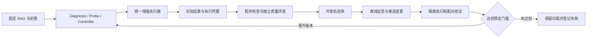

截至 2026-10-23，本项目已具备可复现的 Reference RAG、预实验、冻结的 Diagnosis／Probe／Controller 路由，以及三条增强路线的组件实现。尚未完成统一执行器、三条增强的共同回答质量比较和端到端收益验收。RSI 可以作为后续的轨迹驱动优化层，但目前不能把“模型提出方案”或“组件测试通过”计为闭环改善成功。

本次已成功 `git fetch origin`，核对全部 10 个远端分支和 4 个本地分支，读取模块实现、接口、测试和保存结果。跨分支通过 Git 引用及临时独立快照检查，没有合并、切换、推送工作分支，没有运行新 GPU 实验、训练模型或修改原始数据。已有未跟踪文件 `data/annotations/assisted/answer_repair_v7_batch01_20261017.jsonl` 保留。复核产物在 [审计目录](../artifacts/project_audit_20261023/)，文件哈希、环境和检查范围见 [manifest](../artifacts/project_audit_20261023/manifest.json)。

**分支清单及完成状态。** 分支是否存在、代码是否实现、实验是否取得收益分别判断，不给缺乏共同验收口径的总完成百分比。

| 远端分支 | 核对提交 | 实际内容与边界 |
|---|---|---|
| main | `058f10b` | Reference RAG 和 NQ Train 74,097 条 C1 交付流水线；未整合 Diagnosis 和三个增强。README 的“预实验尚未开始”已过时。 |
| feature/nq-c0-c1 | `bcb248c` | NQ 500 条 C0／C1 预实验。 |
| feature/nq-c3 | `8b03009` | NQ C3、配对恢复分析，含 C0／C1 成果。 |
| feature/fever-c1 | `6ebdfc9` | FEVER 全库索引 C1 500 条和检索 checkpoint、配对分析。 |
| feature/F500-c0c3 | `1238a4f` | FEVER C0／C3 各 500 条及索引 metadata。 |
| feature/-ce-70B | `6f08f2f` | 7B 结果汇合、NQ judge 复评、Llama 70B 的选定难例对照；不是两种模型总体准确率比较。 |
| feature/diagnosis-probe-zheng | `7c7863f` | Diagnosis v2-expanded、Probe、Safe Binary 和 Controller 路由，已有冻结测试；不执行增强。 |
| feature/retrieval-enhancement | `1d97780` | 冻结 NQ P3-20：原问题 BGE Top-20、cross-encoder、等权 RRF、选 Top-5、至多一次重答；有执行记录和回退。默认不改写问题，仅支持 NQ。真实生成收益尚未在分支中提供。 |
| reranking | `338ff34` | 对原 Top-5 用 cross-encoder 重排，默认 keep5，条件式重答；已有检索侧 500 条实验，未验证最终答案改善。 |
| feature/verification-answer-repair | `5da1fe5` | E 历史真实实验、人工结算、Qwen v9／证据 ID／受约束输出；新接口已过合成工程门槛，尚无新的真实语义收益结论。 |

本地 `main`、`feature/F500-c0c3`、E 分支与对应远端相同；本地 `Qihan` 为旧 `c15977c`。远端符号引用 `origin/HEAD` 不另算一个分支。完整文件与相对 main 差异清单见 [branches.json](../artifacts/project_audit_20261023/branches.json)。37 个跨分支预实验相关文件引用对应 15 个唯一 Git blob；同一路径未发现分支间不同字节版本，见 [产物清单](../artifacts/project_audit_20261023/preliminary_artifact_inventory.json)。这项核对是版本一致性核对，不是重新执行全部预实验。

| 功能 | 已完成 | 尚缺的验收 |
|---|---|---|
| Reference RAG | Qwen2.5-7B-Instruct NF4、BGE、FAISS、Top-5，NQ 与 FEVER 实际产出 | 统一运行资源清单及分支集成；Train 与 Dev 使用不同 NQ 检索库，不能混算 |
| Diagnosis | 27 个可观测特征、两级 logistic regression、冻结模型与划分 | accessibility／utilisation 区分很弱；不是多标签能力 profile，也不是已用 7.4 万条训练的 Qwen |
| Probe／Safe Binary | 不确定时至多一次 Qwen Probe，有限地把 failure 改为 correct | 不能修正三个 failure 类型之间的路由错误；降低误报同时漏掉部分真错误 |
| Controller | 四种 action 的确定性映射和运行时数据边界 | 尚缺实际调用三个增强的统一 executor、统一结果与成本结构、执行后反馈 |
| Retrieval Enhancement | P3-20 算法及接口，保护性回退、调用和阶段耗时记录 | FEVER 支持、真实生成和误修结果、全流程 runner／资源装配；提到的 Phase 5–6 外部评分文件未入分支，不能替其确认数值收益 |
| Evidence Refinement | 重排／可选过滤／条件重答及来源检查 | NQ／FEVER 最终答案净收益；当前默认是重排保留全部 5 条，不是默认过滤 |
| E | 多版 GPU 运行、冻结回放、人审、来源定位、预算；新 Qwen 两任务接口 | 实际路由下收益、新接口真实语义验证、新未见评测；没有晋升一个已证明正收益的默认版本 |
| 全系统／RSI／LLM 微调 | 组件接口及部分轨迹字段可复用 | 端到端对照、跨题反思优化、版本晋升／回退、skill registry、memory 更新、蒸馏／DPO 均未完成 |

本次在临时隔离环境重跑：Diagnosis／Probe／Controller 164 项、检索增强 155 项、重排 68 项、E 核心＋v9＋受约束接口 48 项，共 **435 项通过**。都是 CPU 单元／契约检查，模型协作者主要为替身；不等于新 GPU 推理、全量 E 测试或语义验收。初次重排检查因最小环境缺 Torch 出现 1 项导入失败，换已有完整环境后 68 项通过；检索检查在无 `.git` 的归档中有 4 项环境错误，改用同 SHA 的独立 Git checkout 后 155 项通过。两次初始日志及最终日志均保留，未修改被审分支以获得通过。

**已有结果所揭示的系统瓶颈。** 预实验 NQ C1／C3 EM 为 35.2%／51.6%，FEVER 为 80.4%／95.2%，说明证据条件有改善空间；不能直接证明当前三条增强或动态选择有收益，也不能把不同筛选集的准确率相减。

Diagnosis 主测试共 473 条，Diagnosis only accuracy 0.615；加 Probe／Safe Binary 后 0.691，macro-F1 0.370。这里是 diagnosis 标签准确率，不是最终 QA 准确率。Probe 调用 162 次；failure detection recall 从 0.701 降到 0.619。按该分支的离线标签计，实际路由如下：

| action | 总数 | 原本 correct | 真正对应的目标类型 |
|---|---:|---:|---:|
| retrieval_enhancement | 64 | 34 | 22 insufficiency |
| evidence_refinement | 29 | 15 | 1 accessibility |
| generation_repair | 48 | 32 | 9 utilisation |

这些标签是冻结标注口径，不额外宣称全部经过独立人工金标验证。来源为 [上游冻结交接](https://github.com/lzhua020623/capability-aware-slm-rag/blob/7c7863f98f87e892119481a79e23ca6dcebdced0/docs/DIAGNOSIS_PROBE_CONTROLLER_HANDOFF.md) 和该提交的 `results/final/diagnosis_probe_controller_test_evaluation.json`。

一个具体联调缺口：该 Controller 会把 29 条 FEVER 路由到 retrieval_enhancement，而当前默认 P3-20 只支持 NQ，对 FEVER 返回 unsupported_dataset 并保留原答。仅接上函数，不能视为 FEVER 检索增强完成。

重排的 NQ500 实验让包含参考答案的段落处于第一位的数量从 251 增到 272；这是检索侧指标。keep3 会丢失 14 题的答案段落，因此默认改为 keep5。该分支明确没有运行生成模型来确认回答改善。[重排交接](https://github.com/lzhua020623/capability-aware-slm-rag/blob/338ff34b039ed367220b0b916b48c4f7fc715e20/docs/EVIDENCE_REFINEMENT_RERANK.md)

E 最终旧轮次 r3 在开发 75 条中人审正确 64→65；一次性 125 条挑战零改答。v7 的两批 EM 有改善，但人审暴露误修，不能据此宣称稳定净收益。新 XGrammar 的 12 条虚构样例中，受约束输出合规 22/24；只代表结构契约，不是问答准确率。详见 [E 当前交接](ANSWER_REPAIR_HANDOFF.md)。

三个增强目前都有某种“来源存在／答案片段出现”的检查；这不能判断是否找对主体、数量、关系或时间，也不能防止所有误修。统一 executor 应把执行状态、来源合法和语义正确分成不同字段，避免将 answer_replaced 当成 repaired_correct。

**数据完整性已有证据，语义干净和全库隔离仍不能保证。** 本次新扫描了全部 15 份本地 NQ Train C1 JSONL：74,097 条问题、370,485 次证据记录、197,964 个不同 passage ID；并扫描了标准化初标层。检查仅输出统计与 ID，不输出未见部分的问题或答案文本，也没有改原数据及划分。[完整机器结果](../artifacts/project_audit_20261023/nq_delivery_audit.json)

| 检查 | 本次结果 | 含义 |
|---|---|---|
| 原始分片 SHA-256 对 main 清单 | 15/15 一致 | 接收内容完整，不能据此推出语义正确 |
| 样本重复 ID／缺分区／空问题／空答案／空证据 | 均为 0 | 结构检查通过 |
| Top-5 数量、rank、有限分数、ID 对应正文 | 无异常；同一 passage ID 不同正文为 0 | 交付内部一致 |
| Top-5 完全相同正文 | 0 题 | 原始字节去重有效 |
| 统一大小写和空白后重复正文 | 1,258 题 | 完全字节去重仍留下表面变体 |
| Top-5 高度相似段落 | 18,535/74,097，25.01% | 至少一对词级三元组 Jaccard≥0.90，且各含至少 12 个词；只作冗余提示，不是判错率或矛盾判决 |
| 分区 ID 重叠／lowercase＋空白归一问题跨分区 | 均为 0 | 当前基本划分有效 |
| 再统一 NFKC Unicode 与标点后跨分区 | 17 组、35 条，其中 6 组涉及 reserved | 新一轮训练／评测前按组隔离或排除；本次未追改旧 split |
| 跨分区共享 gold passage ID | 4,168 组 | 普通 RAG 共享知识库本身允许；若声称页面／新知识泛化则需单独页面分组 |
| 与已发布 Diagnosis NQ 划分重叠 | 3,216 条原池对新 Train：ID 及 lowercase＋空白归一问题均无重叠 | 只覆盖当前 `7c7863f`；不覆盖语义近重复、页面族或未来／未发布训练 |
| E 暴露登记 | development 301、calibration 125、reserved 0 | 只证明 E 登记范围；不是团队全局未见保证 |

35 个跨分区变体 ID 单独保存于 [隔离候选清单](../artifacts/project_audit_20261023/split_variant_groups.json)，不含题干和答案。上游交叉检查见 [cross_branch_split_audit.json](../artifacts/project_audit_20261023/cross_branch_split_audit.json)。近重复段落可能含不同日期或限定条件，不能为“清洗”而自动删除差异或把重复当作多份独立佐证。

74,097 条新初标全部对齐，标准化层哈希与 10 月 22 日接入记录相同，但未获得可验证的逐条独立人工审核身份。文件来源声明为 73,536 条启发式、561 条选定语义审核，全部保留 preliminary。既有定案开发 75 条中有 36 条与初标不同，11 个已知 E 错误均未被初标标为 E；这一偏选子集不能估算全量错误率。初标可用于抽样和候选筛选，不能直接充当 RSI 的正确反馈或 DPO 偏好。无需等待 7.4 万条全量重审才做下一项固定实验。

全知识库覆盖仍有限：配置路径下 NQ Dev 和 NQ Train 完整 corpus 不在本机；FEVER corpus 的 3,517,244,063 字节文件为 `compressed,dataless` 云盘占位，本次没有扫描其完整字节。不能用上述 Top-5 检查声称审核了 122 万 NQ 段落和 539 万 FEVER 页面。后续应在保存完整 corpus／index 的机器运行全库 ID、空文、重复、编码和索引映射审计，并保留构建指纹；事实、时效与恶意指令等语义问题还需另定范围，模型预训练污染也未被本次审计排除。

当前 NQ 是从样本关联维基页面抽取 `
` 段落、按完整正文去重，并补入未抽到的 gold 长答案段落的受控知识库；FEVER 为配套维基页面记录。不能把 NQ 称为全 Wikipedia 检索，也不能只按配置里的 512／64 就断言语料实际以该长度切块。gold 参与离线语料构建须写进协议；在线 C1／E 使用检索结果而非 gold 字段。NQ 选取单个合格短答案标注，EM 的参考粒度和有效别名问题也需要独立处理，不能把所有 EM 不匹配都用于生成“错误答案”训练对。

**RSI 的建议是先做受控、可回放的两层闭环。** 你提出的轨迹观察、反思、提出方案、实际执行、验收是合理的工程方向。第一版适合称为“基于轨迹的受控自改进”；需要通过跨题验证证明策略改善，不能仅因具有循环或能修改自己的提示就声称递归能力提升。

| 层次 | 输入／动作 | 反馈与更新边界 |
|---|---|---|
| 单题运行闭环 | 问题、检索证据、初答、Diagnosis／Probe；选择 no_action 或三条已定义增强 | executor 实际执行，记录新证据与回答，检查来源、预算和任务完成；超预算／失败保留可用原答。第一版冻结跨题 prompt／memory／skills。 |
| 跨题离线改进闭环 | 仅开发轨迹与可靠评价；提出 prompt 差异、可验证经验或 skill 配置变更 | 在隔离候选目录实际落地；同一开发／选型集做配对比较，达门槛才晋升，失败回退。最终测试不回流优化器。 |

不必先搭 Minecraft 或通用桌面环境。现有 RAG CLI 加上统一工具接口、固定 corpus／index、可复现 runner、版本化状态目录即可构成任务环境。已有三条增强可注册为第一批 skills。第一阶段只开放这些工具及候选 prompt 配置的修改，先固定 memory 和 skill 实现；以后分别消融 memory 更新和 skill 变更，避免同时改变模型、知识库和流程而无法解释收益。

轨迹至少记录：样本及运行 ID、代码／模型／corpus／index 版本、实际加载的 prompt／memory／skill 哈希、检索候选与被选证据 ID／正文指纹、实际送入模型的上下文和截断信息、工具参数与返回／异常、初答／候选／终答、路由理由摘要、token／调用／耗时、最终状态。记录可观测调用和必要决策摘要即可，不应把模型生成的事后解释当作其真实内部计算轨迹。

“确实执行”和“做得正确”由不同检查负责：

| 要证明的事 | 证据 |
|---|---|
| 工具真的被调用 | 执行器产生的调用 ID、参数、返回码、结果产物、失败状态 |
| prompt／memory／skill 修改真的生效 | 变更前后 diff 与哈希；下一次 runner 实际加载的新版本；输入快照可回放 |
| 新回答确实使用可追溯证据 | 合法证据 ID、原文区间、实际输入记录；这仍不证明语义关系正确 |
| 策略确实改善 | 冻结指标上的配对修复／误修、语义支持、成本；独立验证和最终未见评测 |

同一 Qwen 的自评可提供建议；强模型可以辅助检查关系、限定条件及候选优劣，但都不能代替执行凭据，也不能作为无误金标。强模型评价应与原答案／候选的位置偏差隔离，在一部分可靠人审上校准。被优化的 agent 不得修改评分器、测试答案、停止门槛或让测试例进入 memory；外来证据中的指令也不应自动成为 skill 或系统规则。

可参考 [GEPA 论文](https://proceedings.iclr.cc/paper_files/paper/2026/hash/0e9e708b6f48e14fd0ac29e167413f76-Abstract-Conference.html) 与 [官方实现](https://github.com/gepa-ai/gepa)：其利用包括工具调用／输出在内的轨迹反思来提出和测试提示更新，和本次设想接近。可执行 skill 库和环境反馈可参考 [Voyager](https://github.com/MineDojo/Voyager)，其 Minecraft 结果不能直接推断本项目 RAG 效果。项目贡献应验证“Diagnosis 信息与受限增强动作是否使改进更有效／更省预算”，并对照通用提示优化，而不能只宣称搭建了自改进循环。

**蒸馏值得作为后续候选，DPO 暂不作为闭环前置条件。** 两者都改变模型权重；RSI 的提示／memory／skill 优化可以先不训练权重。当前已训练的 Diagnosis 是 logistic regression，不能据此说 Qwen 已被训练。

| 方案 | 本项目适合的训练内容 | 启动条件 |
|---|---|---|
| 教师蒸馏／SFT＋LoRA | 教师在相同可见证据下给出经验证的回答、来源绑定、保留／修复决定；必要时模仿成功工具调用 | 隔离训练数据、验证教师结果、保留正确样本及合理保留行为；不能仅因为教师更大就把输出当真 |
| DPO | 同一问题和上下文下的可靠 chosen／rejected：正确原答 vs 误修、有效修复 vs 错答、正确关系 vs 错误实体／时间 | 已有稳定偏好对，排除两答均错／均合理／未决；验证收益超过 SFT 或提示优化 |
| 全部 74,097 初标直接训练 | 不建议 | failure 类型标签既不是正确回答，也不是答案偏好对；会把现有类别误判蒸馏进去 |

证据利用训练可借鉴 [RAFT](https://arxiv.org/abs/2403.10131) 对相关文档和干扰文档的训练构造；偏好优化可参考 [DPO 原论文](https://arxiv.org/abs/2305.18290) 和 [Context-DPO](https://github.com/byronBBL/Context-DPO)。这些是方法参照，不是本项目的已验证收益。若保持固定基础 RAG 的研究设计，可只训练 E 的独立 adapter，保留原 C1 权重与基线；若更新所有生成模型，则必须建立新版本基线重新比较。

**建议的推进顺序及验收。** 数据审计与工程集成可以并行，不要求先完成全量人工标注。历史实验、原知识库和原 split 保持冻结，新增清洗和训练使用新版本。

| 顺序 | 任务 | 完成标准 |
|---|---|---|
| 1 | 在独立集成分支固定四个功能提交；统一 ActionResult 和 executor | no_action 零增强调用；三条动作真实进入相应模块；明确 FEVER 检索缺口；异常／预算／回退／成本有一致记录 |
| 2 | 收口数据与评测协议 | 处理 17 组问题变体；与团队登记训练、搜索验证、最终测试角色；全库持有机器补审计；标签可信层与初标分开，参考口径固定 |
| 3 | 在同一固定开发集比较基础 RAG、三个单独增强与实际 Controller 路由 | 形成“失败类型 × 动作”的修复、误修和成本矩阵；同时检查全部样本与实际路由子集，避免只挑错题 |
| 4 | 接轨迹驱动的离线 prompt 优化，先不改 memory／skills／权重 | 固定搜索轮数、候选数、总调用预算；有变更落地凭据；对照人工冻结提示及不含 Diagnosis 的优化器 |
| 5 | 冻结候选后运行一次新的未见评测 | FEVER、NQ 分别报告，包含正确答案保护、配对净变化、不确定性、在线和离线优化成本；测试结果不再用于调参 |
| 6 | 依据瓶颈选择小规模教师蒸馏，之后才决定 DPO | 如果主要是理解／关系能力不足，试验独立 E adapter；如果已有好坏候选但选择不稳且偏好可靠，再单独试 DPO |

最终目标是提高固定任务分布下的净正确率，并控制误修和成本。如果可靠的可执行动作在该分布上本身没有收益，RSI 不会仅凭增加反思自动解决；它首先应帮助识别无效动作、停止无效尝试，并为下一项具体能力改进提供可验证的证据。
