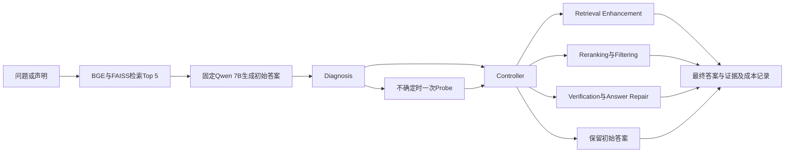

# 项目进度与研究方向

## 当前状态 2026年10月18日

E 当前以 v7 为工作基础，下一轮新修改重新使用 v8 名称，尚未实现。v7 主包 541 条和第 4 批 300 条均已运行一次并通过各自冻结代码回放，合计 836 个唯一 ID；两种策略未晋升默认，可靠净收益及人工语义验收仍待完成。

main 已新增 NQ Train C1 流水线（`058f10b`），并合入 E 分支。Drive 全部 74,097 条已核对并接入 E，原始 diagnosis 标签均为 null；内部用途划分与首批 100 条开发审核材料已固定，见 [接入说明](ANSWER_REPAIR_NQ_TRAIN.md)。有 23,745 条满足 EM=0 且参考段落命中，但这不是 utilisation 标签，需审核确认。新批次无 E GPU 结果，内部评测预留尚需与团队用途协调。

首批 100 条的代理辅助审核已完成：初次建议 69 条可接受、8 条 utilisation 候选、23 条暂缓。用户先确认全部 8 个目标候选，2026-10-18 分两批处理全部 23 条原争议；累计 14 条已定案（11 个内部 E 目标、3 个正确对照）、17 条明确暂缓、69 条未审，见 [审核结果](ANSWER_REPAIR_NQ_TRAIN_REVIEW_20261017.md)。N99 单独确认所求关系的证据缺失，完整主标签仍暂缓，不进入 E 核心。初筛中 49 条建议可接受来自原 EM 不匹配候选，说明筛查混有大量语义等价答案。main 来源字段、gold 和冻结评分均未修改，也没有把审核计数当成 E 提升。

统一审核入口为 [v7 总表](../artifacts/answer_repair/v7_combined_review/review_all.txt)，全部人工字段仍 pending，先审 95 条变化记录（93 个唯一 ID）。第 4 批的诊断分层全部来自上游 AI 初标；其正确性和 failure 类型需与输出语义审核分开确认。

FEVER 预实验池留出集正确数 232→229，NQ 同池留出 EM 71→62；第 4 批 NQ EM 63→67，其中 utilisation 标签层 0→10/120、correct 标签层 63→54/100。冻结指标和代理初读均不能替代人工结论，完整口径见 [v7 结果与路线](ANSWER_REPAIR_RESULTS_20261014_V7.md)。

下一轮使用已有人工确认开发样本进行工程修正，同时审核一小批 v7 关键误修和争议案例；不需要等待全量审核。候选方向为原答案核验、最小修复、候选核验，并做受控消融。需补充新的自然目标错误及正确对照，保留共同未用于选策略的系统测试集；不优先更换主数据集。

早期 10 月 13—14 日的逐次进度、旧路由试跑与阶段性判断已移至 [历史进度](history/answer_repair/PROGRESS_UPDATES_20261013_14.md)。下面保留项目定义、冻结分支和预实验事实；main 更新到 10 月 17 日取得的引用，其余分支仍按原冻结记录。当前交付见 [E 交接](ANSWER_REPAIR_HANDOFF.md)。

## 项目要解决什么

同一个小模型 RAG 出错，可能是没有拿到证据、拿到证据却被噪声干扰，或者证据清楚但答案仍然错误。项目研究这些原因是否对应不同的有效补偿操作，以及按原因选择操作，能否比固定执行全部操作更省成本，同时保持答案质量与证据支持。

Reference RAG 提供共同实验底座。项目的主要贡献需要来自诊断、操作匹配、选择性 Probe，以及质量和成本之间的实验比较。仅增加一条修复 prompt 不足以验证整体研究假设。

## 所有远程分支的实际进度

| 分支 | 核对提交 | 已有产物 | 当前限制 |
|---|---|---|---|
| `main` | `058f10b` | Reference RAG、预实验协议、新 NQ Train 检索/C1/标注交付流水线 | 新 Train 交付标签全 null；未汇合全部后续模块 |
| `feature/nq-c0-c1` | `bcb248c` | NQ C0/C1 各 500 条、续跑脚本 | 没有 NQ C3 |
| `feature/nq-c3` | `8b03009` | 汇合 NQ C0/C1/C3、recoverability cohorts | 没有 FEVER C1 |
| `feature/fever-c1` | `6ebdfc9` | 全量 FEVER 索引 C1 500 条、检索 checkpoint、FEVER 配对分析；包含 NQ 分支成果 | 没有本次 FEVER C0 runner 及其结果 |
| `feature/F500-c0c3` | `1238a4f` | FEVER C0/C3 各 500 条、完整续跑校验、全量索引 metadata | 本地原分支停在 `064447d`，落后 metadata 提交 |
| `feature/-ce-70B` | `6f08f2f` | NQ C0/C1/C3、FEVER C1/C3、NQ judge 复评及 Llama 70B 对照 | 不包含 FEVER C0；没有完成配置中要求的 Qwen 32B 对照 |
| `feature/diagnosis-probe-zheng` | `7c7863f` | normalized 标注、Diagnosis v2-expanded、Probe、Safe Binary、Controller、冻结划分及测试交接 | utilisation/accessibility 路由精度和覆盖有限；上游只做路由，不执行补偿 |
| `reranking` | `338ff34` | 已汇合冻结上游；证据重排接口、68 项 CPU 测试及 NQ frozen500 keep3/keep5 检索侧比较 | 未测最终答案收益；keep5 为开发结果选定默认 |

原有本地 `main`、`Qihan` 都位于 `c15977c`；原有本地 `feature/F500-c0c3` 位于 `064447d`。现已同步远程引用。导致 fetch 失败的非法重复引用 `origin/HEAD 2` 已移到 `.git/codex-backups/origin-HEAD-2-20261011` 保存，原分支提交未改写。

E 开发与交付分支为 `feature/verification-answer-repair`，以 diagnosis 接口分支为基底。其他分支的实验结果通过 Git ref 读取，不需要复制数据集、检索库或重新跑 C1。实现、冻结实验归档和辅助审核一并纳入版本控制，最新交付以该分支的 Git 记录为准，复现入口见 `ANSWER_REPAIR_HANDOFF.md`。

## 预实验已经确认的事实

10 月 11 日逐条核对了以下数据集每个条件的 500 个唯一 ID，并确认 C0/C1/C3 的 ID 集合一致。当时七个远程分支的 `configs/preliminary.yaml` 和两个 sample manifests 字节完全一致。70B 分支保存的 NQ/FEVER C1/C3 文件与原产出分支字节一致。

| 数据集与指标 | C0 无证据 | C1 原始 Top 5 | C3 gold evidence |
|---|---|---|---|
| NQ EM | 51/500 = 10.2% | 176/500 = 35.2% | 258/500 = 51.6% |
| NQ token F1 | 0.1939 | 0.4899 | 0.6778 |
| FEVER accuracy | 360/500 = 72.0% | 402/500 = 80.4% | 476/500 = 95.2% |

来源：NQ 与 FEVER C1/C3 在 `feature/-ce-70B` 的 `results/preliminary/`；FEVER C0 在 `feature/F500-c0c3` 同一目录。

Recoverable Failure Rate 的冻结定义是 `C1 wrong 且 C3-7B correct / C1 wrong`：

| 口径 | C1 错误 | gold evidence 后恢复 | RFR | C1/C3 均错误 |
|---|---|---|---|---|
| NQ 冻结 EM | 324 | 97 | 29.94% | 227 |
| FEVER 冻结标签 | 98 | 80 | 81.63% | 18 |
| NQ judge 复评 | 192 | 125 | 65.10% | 67 |

NQ judge 复评后的 C1/C3 正确率分别为 61.6%/81.8%。冻结指标要求最短 answer span，而一些 gold 字符串更长或存在 token spacing 差异；这会混入评测误判。Judge 文件有 626 条 C1/C3 verdict，包含 566 条 EM 错误答案和 60 条 EM 正确答案的检查。60/60 一致只验证了这一批已正确答案，不能证明 judge 没有宽松误判。冻结 EM 和 judge 复评必须分别报告，不能把复评结果写成已经完成的人类金标准标注。

更大模型对照实际使用 Llama-3.3-70B：NQ 在 judge 修正后的 67 个 persistent failures 上，EM 恢复 8 个、judge 恢复 15 个；FEVER 在 18 个 persistent failures 上恢复 8 个。统一采用该分支复评口径时合计为 23/85。它支持“这些选中的 7B 失败中有一些可由该 70B 模型恢复”，不能独立证明参数规模是原因，也不能比较两个模型的总体准确率；模型家族、推理环境及评测口径都发生了变化。剩余 62 个案例应称为当前设置下尚未解决，不能据此断言不可修复。

C3 的一次直接生成也不是所有外部补偿策略的严格上界。由上述配对计数可得，NQ 有 15 个、FEVER 有 6 个样本在 C1 正确而 C3 错误；改变提示、约束输出或增加核验可能产生不同结果。

## Diagnosis 与标注状态

10 月 13 日远端已发布上述产物，替代 10 月 11 日“仅接口、未找到标签”的历史结论。`feature/diagnosis-probe-zheng` 中有 `fever_500_labels.jsonl`、`nq_500_labels.jsonl` 和 `nq_3216_labels_normalized.jsonl`，以及训练/验证/测试划分、classifier 参数和冻结评测。它们是项目样本的四类 diagnosis 标注，不是原始 FEVER/NQ benchmark 全量 failure 标注。

Diagnosis v2-expanded 使用 NQ 1889/406/403、FEVER 331/71/71 的 train/validation/test 划分；过滤 `needs_manual_review` 后还有未纳入样本。上游 PRIMARY test 473 条 pipeline accuracy 0.691、macro-F1 0.370、utilisation F1 0.217。E 路由 48 条中只有 9 条标注 utilisation，32 条原本 correct，因此必须评估误路由下的误修风险。详细来源为冻结 `DIAGNOSIS_PROBE_CONTROLLER_HANDOFF.md`，这些汇总只用于交接，没有使用测试单条数据调 E。

当前 `gold_evidence_in_top5` 是离线检索命中标记。FEVER 代码按任意 gold page 命中判断，命中页面不能保证所需全部证据句或证据组合存在。NQ 命中 gold passage 也不能证明上下文已经清晰。不能直接用这个布尔值区分 accessibility 与 utilisation，更不能把它输入在线 diagnosis 或 E。

## Proposal 与实际实现需要对齐的地方

| 项目 | Proposal v21 | 仓库实际状态与建议 |
|---|---|---|
| 运行模型 | 3B 候选，视 pilot 调整到 3B–7B | 已冻结 Qwen2.5-7B-Instruct、NF4、greedy；主实验继续保持这一设置 |
| 大模型对照 | 同家族 14B，资源允许时增加 32B | 冻结配置改为要求 32B；实际跑的是 Llama 70B。报告需要如实记录替代及其限制 |
| C2 | 清洗/重排 C1 中已有证据的 accessibility control | 冻结预实验明确排除 C2。需要补充该控制或明确采用人工证据审核等替代标签依据；E 的结果命名为 `E` |
| diagnosis | 三个独立 sigmoid 分数，允许多标签 | 接口只有一个主标签、confidence、needs_probe。主标签可用于 MVP 路由，但不等价于多标签 profile；不能按当前接口宣称满足 FR6 |
| Evidence Utilisation 标签 | C3 下仍错误/unsupported | 当前 runtime 定义是实际 C1 证据清楚充分但回答错误。两种条件有差异；离线 oracle failure 不能直接等同于在线 C1 utilisation |
| 证据支持核验 | 共用轻量 NLI，并审核 unresolved flags | E v6r1 已冻结并实测独立 MNLI，记录完整概率与成本；存在错误实体误判，尚未验收 faithfulness 或接成全系统共用核验组件 |
| Probe 推断 | 响应变化用于更新 failure profile | 响应变了不一定更正确；响应没变不证明能力限制。需要核验证据支持，并对 Probe 的诊断收益做消融 |

建议保留“固定 7B + 原因诊断 + 选择性补偿 + 质量/成本比较”的主线，先把能复现实验的 MVP 做实。若采用单主标签简化，报告应明确这是工程调整；若坚持 proposal 的多标签要求，需要由 diagnosis 负责人扩展 profile 输出及评测，E 本身无需改变。

## 下一阶段需要验证的假设

第一步：冻结标签依据和 ID 划分，检查 NQ judge 翻转样本，补足 accessibility/utilisation 的证据。已有 500+500 预实验样本可作开发材料；若它们用于挑选策略或阈值，最终主结果宜采用剩余未使用样本作为独立评测集。资源限制下复用这些样本时，应报告为探索性结果。

第二步：三个补偿操作分别可运行。E 先在包含原本正确及错误答案的固定开发样本上运行 Always-Verify，统计改对、改错、解析失败与成本；再接 diagnosis 主标签做选择性修复。单独在已知错误集上跑不能测量误修风险，也不能证明总体提升。

第三步：按 diagnosis 分组，每个样本都评测三个操作，形成“失败类型 × 操作”的效果矩阵。只有此时才能验证图中的对应关系。对同一批样本使用配对比较和置信区间；若有多重比较，应在解释显著性时处理相应影响。

第四步：端到端比较 Vanilla RAG、Always-Rerank、Always-Verify、Full Enhancement 和 adaptive framework；另比较无 Probe 与选择性 Probe。记录包括 diagnosis 特征提取在内的全部模型调用、token、延迟，不能只计补偿操作的成本。

E 的交付和执行方法见 [ANSWER_REPAIR.md](ANSWER_REPAIR.md)，最新真实结果见 [v7 报告](ANSWER_REPAIR_RESULTS_20261014_V7.md)。v7 两批合计 841 条已通过冻结代码回放；可靠净收益与人工 faithfulness 验收尚未完成。后续结合已有开发样本与关键人工复核设计下一轮，再由团队开展三个操作的共同未见评测。

## 方法依据

[D2R-RAG](https://proceedings.mlr.press/v318/hashemifar26a.html) 已研究 observable diagnosis 和预算约束下的 repair selection。因此整体贡献要通过小模型失败类型、选择性 evidence Probe 和质量/成本实验具体体现。

[Self-Refine](https://arxiv.org/abs/2303.17651) 提供同一模型反馈和修订的研究参照；[自纠错局限研究](https://arxiv.org/abs/2310.01798) 在其推理设置中发现，缺少外部反馈的自纠错可能无效或造成退化。它们不直接给出本项目 7B 的效果，E 的证据约束及误修率需要实测。
