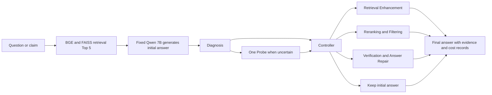

# Project Progress and Research Direction

## Current entry · 2026-10-28

[Expansion and timeout recovery](E_TEACHER_EXPANSION_20261028.md): the user's latest instruction "can go straight to 5000" keeps the US$40 cumulative cap and supersedes "2000 first". The original 2,000 batch stopped at the newly added 55th request with a TimeoutError; the first 54 items have been independently replayed, for a cumulative 554 complete candidates; the known unit-price estimate is US$3.784529, the unknown request is fully reserved at US$0.13211, and accounting continues at US$3.916639. The original 55-request ledger and responses are frozen; recovery does not resend the 55th request, does not refund and does not re-collect, and continues from 56 for at most 4,445 requests; all post-pilot requests total 4500, with at most 4999 complete candidates. The new timeout is 600 seconds, with fixed teacher/prompt/Top-5/output budget/zero retries. Training has still not started; Development500 evaluates the student, Selection500 is a one-time confirmation, Test is untouched. The original 100-item chat batch approval and the two temporary training-entry isolation items are kept; no claim of 100% semantic accuracy or student benefit is made.

10/28 remote re-check: 13 branches of the main repository and two forks have been checked; of these, the 11,114 predictions, metrics and Judge of baseline `10601c5` are already in `baselines/outputs/` in this directory. Reranking `d4d9e45` is still 11 commits ahead of the merged `1d51856`; this item has not yet been merged. Diagnosis is still the merged `138d52a` and retrieval enhancement `37e469e`; the gaps in P60 raw online features and training provenance have not disappeared because the baseline results arrived. E collection and component sync proceed in parallel.

[E teacher pilot production of 500 items completed](E_TEACHER_PILOT_RESULTS_20261028.md): all Azure GPT-6.1 Sol outputs passed independent source/contract/ledger replay, 49 replaced and 451 kept, with targets at most 126 tokens; conservative accounting $6.58152. Offline EM serves only as a teacher pilot-production diagnostic: 95→112 (18 fixed, 1 broken), not a benefit of distilled Qwen or of the final test. The original review snapshot keeps its historical state, and the latest chat batch approval is registered separately; SFT has not started. In the formal 11,114-item test, generation_repair has been run, and 1575 items have status success. The original C1, routing and team data isolation are unchanged.

## Historical entry · 2026-10-27

Latest [E output distillation preparation](E_DISTILLATION_V1.md): the new T5-D extension fixes the existing five-field contract, with a balanced 500-item pilot production within Train and independent development/selection sets of 500 each in Validation. The first 3-item real connection check of Azure GPT-6.1 Sol on 2026-09-29 has passed version, source and structural replay, with all targets below 384 tokens, conservative accounting $0.04104; this is not semantic acceptance or a repair gain. Continuing on the same ledger for at most 500 requests/15 USD; the full pilot production and SFT are not yet completed. Current C1, routing and E unavailable are unchanged; the P60 material gap still blocks end-to-end runs of the new main line.

After the preparation commit, the reranking branch was updated to `1d51856`, with selector evaluation and an explicit Top-N candidate pool compatibly added, see the [new integration notes](RERANK_1D51856_INTEGRATION.md). The current default weights, Top-5 and the E teacher task are unchanged; the new tools keep team data and resource fingerprint checks.

Latest [team data alignment and boundaries](TEAM_DATA_BOUNDARIES.md): the NQ split was ingested as original bytes, the 74,097 IDs are consistent with the initial-label count metadata, and the hashes of the 15 local raw C1 shards pass; structural checks on the allowed pool of 46,421 Train / 9,440 Validation pass. Known downstream test exposure has expanded to 603; the team's original 11,114-item test is kept, without claiming that all of it is completely unseen. New training and the current production entry perform usage checks; new baseline per-question outputs and FEVER unification are still to be supplied.

The subsequent working branch is `controller_2`: created from `5da8fa6`, it has compatibly merged retrieval enhancement `37e469e` and reranking `5583285`, see the [merge handoff](CONTROLLER2_INTEGRATION.md). The newly added reranking training, random/truncation controls, candidate-answer trajectories and retrieval-enhancement result audits keep their respective provenance; current default weights and budget are unchanged. E distillation has not yet started, and the missing P60 items continue to block real runs. Subsequently, NQ registered the team's 51,866/11,117/11,114 split and applied conservative usage isolation; the old T4/T5 are kept, and new baseline per-question outputs and the models' original usage IDs are still to be delivered.

The user specified that the October 24 Diagnosis `138d52a` is the baseline from now on; this commit is already in the controller history. Newly added [current baseline registration and real module adaptation](CONTROLLER_1024_BASELINE.md): C1 → Diagnosis → P60 → Controller → EnhancementExecutor, Probe OFF; the production entry is `src.pipeline.current.load_current_pipeline()`, and the old T4/T5 entries are only for historical reproduction. E remains unavailable. Real enhancement implementations have been wired up with metering kept; the original 78-dimensional feature generation code and the training/tuning ID provenance of the three HGBs are still missing, so the production check explicitly stops; no GPU has been started and no new routing benefit is claimed. The existing T5 0.2 candidate has been rejected, and its results cannot be taken as P60's results. Current tasks are in [T1–T9](CONTROLLER_TASKS.md).

## Historical entry · 2026-10-26

Current branch `controller`. The new framework of Diagnosis `138d52a` has been compatibly merged, P60 is not enabled, and the default Diagnosis/Probe routing is unchanged, see the [integration review](DIAGNOSIS_138D52A_INTEGRATION.md). The first r2 GPU run is complete: all 18 short questions + 2 long questions ran, 10 passed, 1 structural failure, 9 semantic failures, 0 execution failures; the independent ZIP audit agrees. Per pre-registration, all E groups are uniformly frozen as unavailable, real development calls are 0, FR12 is not accepted, and the main line no longer schedules r3. See the [raw results](../artifacts/controller/e_v2a_interface_r2/kaggle_v1/README.md) and the [current T1–T9](CONTROLLER_TASKS.md). The assisted opinions on 17 questions have been adopted by the user; 11 questions are fully finalized and 6 are still not fully finalized, see the [review record](../artifacts/controller/t5_human_review_v1/README.md). Development replay of three thresholds has been completed in fixed unavailable mode, and the single NQ 0.2 candidate was frozen and sent to one selection run: EM 78→81, the semantic net value may still be negative, and no benefit is claimed, see the [candidate rationale](../artifacts/controller/t5_candidate_v1/README.md). The first selection run [Kaggle 362316572](https://www.kaggle.com/code/yearo111/controller-t5-selection-frozen-20261026?scriptVersionId=362316572) completed successfully and was independently audited: 400 questions/2,000 items complete, six active long paths and two historical queries passed, call/budget failures are 0. Under frozen scoring, the original Adaptive is NQ 89→93 and FEVER 163→164; the single NQ 0.2 candidate relative to the original routing is 93→90 (3 fixed/6 broken), so per the rules promotion is rejected, the original routing is kept, and no other thresholds are searched. See the [raw results and selection-run report](../artifacts/controller/t5_selection_v1/kaggle_v1/README.md). Semantic review of NQ's 15 candidate changed-answer pairs is still pending, and EM regressions are not treated as human-reviewed harmful repairs; final evaluation has not started. The branch and E status below are historical snapshots.

## Historical entry · 2026-10-25

The development branch is `controller`, historical branches are integrated, and T3 real-GPU engineering acceptance has passed. The [T4 full development results](../artifacts/controller/t4_v1/README.md) have been downloaded and accepted, scored offline, and independently ZIP-replayed consistently: 200 items per dataset, all seven groups with 2,800 items complete, call/budget failures 0. A missing field in the final GPU summary caused a failure; predictions were unaffected, and it has been patched and passed 774 regression tests. Adaptive's NQ EM is 78→78 and FEVER labels 170→174; E alone is NQ 78→68 and FEVER 170→166. These are development observations only; 104 NQ changed-answer pairs and 51 warning trajectories still await human review, and T5/selection run/final test have not started. Old preliminary C1, NQ Train C1, the new FEVER 900-item C1 and two full sets of retrieval resources are all in place; existing C1 is not rerun. This entry takes precedence over the historical status below; T1/T2 and gold are unchanged.

## Current status, October 19, 2026

E has implemented [v8 conservative repair](ANSWER_REPAIR_V8.md) and completed four groups of GPU experiments on 75 NQ Train items plus a 300-item frozen decision replay. In full v8, original-answer verification fell back as invalid on all 75 items and none entered repair; the original 15 new changed answers await human review, and the subsequent r3 has fixed the engineering contract but semantic verification remains limited, see [v8 results](ANSWER_REPAIR_RESULTS_20261019_V8.md). The v7 historical main package of 541 items and batch 4 of 300 items have passed their respective frozen replays, totalling 836 unique IDs; none of the policies has been promoted to default, and reliable net benefit still awaits acceptance.

The fixed 8 items of v8r3, four groups of 32 GPU outputs, are complete and passed frozen replay, v8 format errors are 0, and the engineering threshold is passed. The full pipeline changed the answer only for N96, which the assisted judgement deems a naming-rationale repair, still awaiting human review; EM 1→1, and N8/N31 wrongly accepted and N48's correct candidate wrongly rejected still remain. See [r3 results](ANSWER_REPAIR_RESULTS_20261019_V8_R3.md). The next step separately validates a semantic verification method that first extracts evidence facts and then compares the reviewed answer; the 75-item rerun has not been started, and the policy has not been promoted to default.

main has added the NQ Train C1 pipeline (`058f10b`), and it has been merged into the E branch. All 74,097 Drive items have been checked and ingested into E, and the original diagnosis labels are all null; the internal usage split and the first batch of 100 development review materials are fixed, see the [ingestion notes](ANSWER_REPAIR_NQ_TRAIN.md). 23,745 items satisfy EM=0 with a reference-passage hit, but this is not a utilisation label and requires review to confirm. This round runs only 75 finalized development samples among them, and the internal evaluation reserve still needs coordination with team usage.

The assistant's assisted review of the first 100 items is complete, initially suggesting 69 acceptable, 8 utilisation candidates and 23 deferred. In the first six batches the user gave opinions on all 100 items, completing the first pass: 75 finalized (11 internal E targets, 64 correct controls), 25 pending, 0 not reviewed, see [review results](ANSWER_REPAIR_NQ_TRAIN_REVIEW_20261017.md). N76 was checked as the same entity as the original C1 using the Dutch Saint Nicholas source notes provided by the user, with the interpretive basis marked; the 25 pending include 17 originally deferred and 8 with condition/criteria requirements. N99 has been separately confirmed to lack evidence for the requested relation, and its full primary label remains deferred; N58's 21 is qualified by the purchase type/channel in the original evidence, and N83's supplementary time comes from a July 2018 snapshot. The user's original words, the assistant's disagreements and unresolved fields are kept separately; completing the pass does not mean all primary labels or full-data annotation are complete.

Currently 75 finalized development inputs are fixed (11 E targets and 64 correct controls), 25 pending items are isolated, and four groups of real outputs are complete. Primary sources, gold and frozen scoring are unmodified. In the initial screen, 49 items suggested as acceptable came from EM-mismatch candidates, showing that the screen mixes in semantically equivalent answers; a selected development set and the number of human reviews cannot be taken as E net benefit.

The unified review entry is the [v7 combined table](../artifacts/answer_repair/v7_combined_review/review_all.txt); all human fields are still pending, and the 95 changed records (93 unique IDs) are reviewed first. Batch 4's diagnosis strata all come from upstream initial AI labels; their correctness and failure types need to be confirmed separately from output semantic review.

FEVER preliminary-pool held-out correct count 232→229, NQ same-pool held-out EM 71→62; batch 4 NQ EM 63→67, of which the utilisation label stratum 0→10/120 and the correct label stratum 63→54/100. Neither frozen metrics nor the assistant's initial reading can replace human conclusions; full criteria are in [v7 results and roadmap](ANSWER_REPAIR_RESULTS_20261014_V7.md).

r3 has completed small-batch real-model acceptance of the output grammar. The next round uses existing development samples to separately compare a semantic gate method that extracts evidence facts per question and then verifies the answer; new changed answers and the key old v7 harmful repairs are reviewed in parallel, without waiting for full review. Then the four fixed development experiments are rerun, adding natural target errors and correct controls, and keeping a shared system test set not used for policy selection; replacing the main dataset is not a priority.

The early October 13–14 step-by-step progress, old routing trial runs and interim judgements have been moved to [historical progress](history/answer_repair/PROGRESS_UPDATES_20261013_14.md). Below, the project definition, frozen branches and preliminary-experiment facts are kept; main is updated to the reference obtained on October 17, and the other branches still follow the original frozen records. Current delivery is in the [E handoff](ANSWER_REPAIR_HANDOFF.md).

## What the project aims to solve

When the same small-model RAG makes an error, it may be because it did not get the evidence, got the evidence but was distracted by noise, or had clear evidence yet still answered wrongly. The project studies whether these causes correspond to different effective compensating operations, and whether selecting operations by cause can be cheaper than always executing all operations while maintaining answer quality and evidence support.

Reference RAG provides the shared experimental foundation. The project's main contribution needs to come from diagnosis, operation matching, selective Probe, and experimental comparison between quality and cost. Merely adding one repair prompt is not enough to validate the overall research hypothesis.

## Actual progress of all remote branches

| Branch | Checked commit | Existing artifacts | Current limitations |
|---|---|---|---|
| `main` | `058f10b` | Reference RAG, preliminary-experiment protocol, new NQ Train retrieval/C1/annotation delivery pipeline | New Train delivery labels are all null; not all later modules are merged |
| `feature/nq-c0-c1` | `bcb248c` | NQ C0/C1 500 items each, resume script | No NQ C3 |
| `feature/nq-c3` | `8b03009` | Merges NQ C0/C1/C3, recoverability cohorts | No FEVER C1 |
| `feature/fever-c1` | `6ebdfc9` | Full FEVER index C1 500 items, retrieval checkpoint, FEVER paired analysis; includes NQ branch results | No FEVER C0 runner from this round or its results |
| `feature/F500-c0c3` | `1238a4f` | FEVER C0/C3 500 items each, full resume validation, full index metadata | The original local branch stopped at `064447d`, behind the metadata commit |
| `feature/-ce-70B` | `6f08f2f` | NQ C0/C1/C3, FEVER C1/C3, NQ judge re-evaluation and Llama 70B comparison | Does not include FEVER C0; the Qwen 32B comparison required in the config was not completed |
| `feature/diagnosis-probe-zheng` | `7c7863f` | normalized annotations, Diagnosis v2-expanded, Probe, Safe Binary, Controller, frozen split and test handoff | utilisation/accessibility routing precision and coverage are limited; upstream only routes and does not execute compensation |
| `reranking` | `338ff34` | Merged the frozen upstream; evidence reranking interface, 68 CPU tests, and NQ frozen500 keep3/keep5 retrieval-side comparison | Final answer benefit not measured; keep5 was chosen as the default from development results |

The original local `main` and `Qihan` were both at `c15977c`; the original local `feature/F500-c0c3` was at `064447d`. Remote references are now synced. The illegal duplicate reference `origin/HEAD 2` that caused fetch failures has been moved to `.git/codex-backups/origin-HEAD-2-20261011` for safekeeping; original branch commits were not rewritten.

The E development and delivery branch is `feature/verification-answer-repair`, based on the diagnosis interface branch. Experimental results from other branches are read via Git refs, with no need to copy datasets or retrieval corpora or rerun C1. Implementation, frozen experiment archives and assisted reviews are all under version control; the latest delivery is per this branch's Git history, and the reproduction entry is in `ANSWER_REPAIR_HANDOFF.md`.

## Facts confirmed by the preliminary experiments

On October 11, the 500 unique IDs of each condition of the following datasets were checked item by item, confirming that the C0/C1/C3 ID sets are identical. At that time, `configs/preliminary.yaml` and the two sample manifests on the seven remote branches were byte-for-byte identical. The NQ/FEVER C1/C3 files saved on the 70B branch are byte-identical to those on the original producing branches.

| Dataset and metric | C0 no evidence | C1 original Top 5 | C3 gold evidence |
|---|---|---|---|
| NQ EM | 51/500 = 10.2% | 176/500 = 35.2% | 258/500 = 51.6% |
| NQ token F1 | 0.1939 | 0.4899 | 0.6778 |
| FEVER accuracy | 360/500 = 72.0% | 402/500 = 80.4% | 476/500 = 95.2% |

Sources: NQ and FEVER C1/C3 are in `results/preliminary/` on `feature/-ce-70B`; FEVER C0 is in the same directory on `feature/F500-c0c3`.

The frozen definition of Recoverable Failure Rate is `C1 wrong and C3-7B correct / C1 wrong`:

| Criteria | C1 wrong | Recovered with gold evidence | RFR | Both C1/C3 wrong |
|---|---|---|---|---|
| NQ frozen EM | 324 | 97 | 29.94% | 227 |
| FEVER frozen labels | 98 | 80 | 81.63% | 18 |
| NQ judge re-evaluation | 192 | 125 | 65.10% | 67 |

After NQ judge re-evaluation, C1/C3 accuracy is 61.6%/81.8% respectively. The frozen metric requires the shortest answer span, while some gold strings are longer or have token spacing differences; this mixes in evaluation misjudgements. The Judge file has 626 C1/C3 verdicts, including checks of 566 EM-wrong answers and 60 EM-correct answers. 60/60 agreement only validates this batch of already-correct answers and cannot prove that the judge has no lenient misjudgements. Frozen EM and judge re-evaluation must be reported separately, and re-evaluation results must not be written up as completed human gold-standard annotation.

The larger-model comparison actually used Llama-3.3-70B: on the 67 persistent failures after judge correction, NQ recovered 8 by EM and 15 by judge; FEVER recovered 8 of 18 persistent failures. Using that branch's re-evaluation criteria uniformly, the total is 23/85. This supports "some of these selected 7B failures can be recovered by this 70B model", but cannot independently prove that parameter scale is the cause, nor compare the two models' overall accuracy; model family, inference environment and evaluation criteria all changed. The remaining 62 cases should be called unresolved under the current setup, and must not be asserted to be unrepairable on this basis.

A single direct generation under C3 is also not a strict upper bound for all external compensation strategies. From the paired counts above, NQ has 15 and FEVER 6 samples that are correct under C1 but wrong under C3; changing prompts, constraining output or adding verification may produce different results.

## Diagnosis and annotation status

On October 13, the remote published the above artifacts, replacing the October 11 historical conclusion of "interface only, no labels found". `feature/diagnosis-probe-zheng` contains `fever_500_labels.jsonl`, `nq_500_labels.jsonl` and `nq_3216_labels_normalized.jsonl`, as well as the train/validation/test split, classifier parameters and frozen evaluation. These are four-class diagnosis annotations of project samples, not full failure annotations of the original FEVER/NQ benchmarks.

Diagnosis v2-expanded uses NQ 1889/406/403 and FEVER 331/71/71 train/validation/test splits; after filtering `needs_manual_review` there are still samples not included. Upstream PRIMARY test, 473 items: pipeline accuracy 0.691, macro-F1 0.370, utilisation F1 0.217. Of the 48 items routed to E, only 9 are labelled utilisation and 32 were originally correct, so harmful-repair risk under misrouting must be evaluated. The detailed source is the frozen `DIAGNOSIS_PROBE_CONTROLLER_HANDOFF.md`; these summaries are used only for handoff, and no individual test items were used to tune E.

The current `gold_evidence_in_top5` is an offline retrieval hit flag. The FEVER code judges by a hit on any gold page, and a hit page does not guarantee that all required evidence sentences or evidence combinations are present. An NQ gold passage hit also does not prove that the context is clear. This boolean cannot be used directly to distinguish accessibility from utilisation, much less be fed into online diagnosis or E.

## Where the Proposal and the actual implementation need to be aligned

| Item | Proposal v21 | Actual repository status and recommendation |
|---|---|---|
| Run model | 3B candidate, adjusted to 3B–7B depending on the pilot | Frozen at Qwen2.5-7B-Instruct, NF4, greedy; the main experiments keep this setup |
| Large-model comparison | Same-family 14B, adding 32B if resources allow | The frozen config was changed to require 32B; Llama 70B was actually run. The report must faithfully record the substitution and its limitations |
| C2 | Accessibility control that cleans/reranks the existing evidence in C1 | The frozen preliminary experiment explicitly excludes C2. Either add this control or explicitly adopt an alternative label basis such as human evidence review; E's results are named `E` |
| diagnosis | Three independent sigmoid scores, allowing multiple labels | The interface has only one primary label, confidence, needs_probe. The primary label can be used for MVP routing but is not equivalent to a multi-label profile; meeting FR6 cannot be claimed with the current interface |
| Evidence Utilisation label | Still wrong/unsupported under C3 | The current runtime definition is that the actual C1 evidence is clear and sufficient but the answer is wrong. The two conditions differ; an offline oracle failure cannot be directly equated with online C1 utilisation |
| Evidence support verification | Shared lightweight NLI, with review of unresolved flags | E v6r1 has frozen and tested an independent MNLI, recording full probabilities and cost; there are wrong-entity misjudgements, and it has not yet been accepted for faithfulness or wired in as a system-wide shared verification component |
| Probe inference | Response changes are used to update the failure profile | A changed response is not necessarily more correct; an unchanged response does not prove a capability limitation. Evidence support must be verified, and Probe's diagnostic benefit must be ablated |

It is recommended to keep the main line of "fixed 7B + cause diagnosis + selective compensation + quality/cost comparison", and first make a reproducible MVP solid. If the single-primary-label simplification is adopted, the report should state clearly that this is an engineering adjustment; if the proposal's multi-label requirement is upheld, the diagnosis owner needs to extend the profile output and evaluation, and E itself does not need to change.

## Hypotheses to validate in the next stage

Step 1: freeze the label basis and ID split, check the NQ judge-flipped samples, and supplement evidence for accessibility/utilisation. The existing 500+500 preliminary samples can serve as development material; if they are used to select policies or thresholds, the final main results should use the remaining unused samples as an independent evaluation set. When these samples are reused under resource constraints, they should be reported as exploratory results.

Step 2: each of the three compensation operations can run. E first runs Always-Verify on a fixed development sample containing both originally correct and wrong answers, counting fixed-to-correct, changed-to-wrong, parse failures and cost; then it connects the diagnosis primary label for selective repair. Running only on a known-error set cannot measure harmful-repair risk, nor prove an overall improvement.

Step 3: group by diagnosis and evaluate all three operations on every sample, forming a "failure type × operation" effect matrix. Only then can the correspondence in the figure be validated. Use paired comparisons and confidence intervals on the same batch of samples; if there are multiple comparisons, handle their impact when interpreting significance.

Step 4: compare end to end Vanilla RAG, Always-Rerank, Always-Verify, Full Enhancement and the adaptive framework; also compare no Probe with selective Probe. Record all model calls, tokens and latency, including diagnosis feature extraction; the cost must not be counted for the compensation operations alone.

E's delivery and execution method is in [ANSWER_REPAIR.md](ANSWER_REPAIR.md), and the latest real results are in the [v7 report](ANSWER_REPAIR_RESULTS_20261014_V7.md). v7's two batches totalling 841 items have passed frozen code replay; reliable net benefit and human faithfulness acceptance are not yet completed. Next, the next round will be designed using existing development samples and key human re-reviews, and then the team will carry out a shared unseen evaluation of the three operations.

## Methodological basis

[D2R-RAG](https://proceedings.mlr.press/v318/hashemifar26a.html) has already studied observable diagnosis and repair selection under budget constraints. Therefore the overall contribution must be concretely demonstrated through small-model failure types, selective evidence Probe, and quality/cost experiments.

[Self-Refine](https://arxiv.org/abs/2303.17651) provides a research reference for same-model feedback and revision; [a study on the limits of self-correction](https://arxiv.org/abs/2310.01798) found in its reasoning setting that self-correction without external feedback may be ineffective or cause degradation. They do not directly give the effect for this project's 7B; E's evidence constraints and harmful-repair rate need to be measured.
